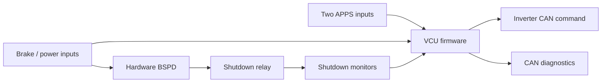

# MKVIII Vehicle Control Unit

The VCU combines the former throttle and Brake System Plausibility Device (BSPD)
functions on an STM32G441. It reads two Accelerator Pedal Position Sensor (APPS)
channels, brake signals, and shutdown monitors, then sends torque and enable
commands to the CM200DX inverter over CAN. The hardware BSPD can open the
shutdown relay independently of the firmware.

- The 1 ms control task reads inputs, evaluates faults, and updates local outputs;
  CAN commands and diagnostics are scheduled every 10 ms.
- CAN uses 500 kbit/s and standard identifiers: `0x0C0` for the inverter command,
  and temporary IDs `0x700` / `0x701` / `0x702` for throttle, BSPD, and VCU status.
- Every reported fault disables the inverter request and clears ready-to-drive
  (RTD). Torque stays zero outside `RUN`, including while braking.
- RTD requires a new start-button press with the brake applied, pedal near idle,
  and no faults. The normal `vcu.elf` subscribes to the legacy dashboard message
  through [vcu.yml](vcu.yml) and checks its start button locally.
- Pin mappings and thresholds are in [vcu_config.h](vcu_config.h); measured CAN
  transmit results and monitor commands are in [CAN_BENCH_TEST.md](CAN_BENCH_TEST.md).



**Fault checks and recovery**

`vcu_status.fault_bits_lo` is a bitmask: several faults can be present together.
Bit `n` contributes `2^n`; zero means no reported faults. For example,
`152 = 8 + 16 + 128` is `0b0000000010011000`: bits 3, 4, and 7 are set,
counting from bit 0 at the right. Firmware explicitly sets `fault_bits_hi` to
zero; its internal fault state is only 16 bits, so high-word fault reporting is
not implemented. Bits 11-15 of the low word are unused. Names below omit the
`VCU_FAULT_` prefix.
Definitions are in [Inc/vcu.h](Inc/vcu.h), with checks in [Src/vcu.c](Src/vcu.c)
and component locations in the [hardware schematics](../../../hardware/lv/VCU).

| Bit | Decimal value | Fault and meaning | Check in this order | Recovery |
| ---: | ---: | --- | --- | --- |
| 0 | 1 | `APPS1_OUT_OF_RANGE`: left pedal reading outside calibration. | Supply/ground -> B10 voltage -> `throttle_l_raw >> 2` against left limits in `vcu_config.h`. The shift divides raw counts by four. | Restore valid input; clears automatically. Bit 3 may remain latched. |
| 1 | 2 | `APPS2_OUT_OF_RANGE`: right pedal reading outside calibration. | Supply/ground -> B11 voltage -> `throttle_r_raw >> 2` against right limits, also using raw counts divided by four. | Restore valid input; clears automatically. Bit 3 may remain latched. |
| 2 | 4 | `APPS_MISMATCH`: pedal positions disagree. | Compare scaled percentages, then wiring/calibration. Difference >25/255 (about 10 percentage points) triggers this bit; equal raw voltages need not mean equal positions. | Restore agreement; clears automatically. Clear bit 3 separately if latched. |
| 3 | 8 | `APPS_TIMEOUT_LATCHED`: out-of-range or mismatched pedals persisted for at least 100 ms. | Diagnose bits 0-2. A zero `throttle_implaus_timer_ms` does not mean the latch cleared. | Restore valid, matching inputs, then restart the MCU. |
| 4 | 16 | `INERTIA_SWITCH_OPEN`: inertia shutdown segment appears open. | External circuit/ground -> B12 voltage -> TP11. Q5 inverts the signal; healthy MCU sense is LOW. | Restore the external circuit; clears automatically when TP11 goes LOW. |
| 5 | 32 | `BSPD_POWER_LATCHED`: hardware BSPD latch/output indicates a trip. | Check `brake_gate` and `bspd_5kw`, then the RC timing node and TP6 (`BSPD_LL`). LOW TP6 reports a trip. | Remove the cause, then fully power-cycle the board's 3.3 V latch supply. MCU reset alone cannot clear it. |
| 6 | 64 | `BRAKE_THROTTLE_IMPLAUS`: brake applied with both pedal channels at least 64/255 (about 25%). | Check `brake_gate`, then scaled pedal values. Unexpected braking: inspect B6 and the brake circuit. | Release the pedal; clears when the lower scaled channel falls to 12/255 or less (about 5%). |
| 7 | 128 | `SHUTDOWN_BSPD_OPEN`: shutdown path after the BSPD relay appears open. | A17/A18 input voltage -> K1 -> B17/B18 output voltage -> TP10. Healthy MCU sense is LOW. | Restore supply and relay continuity. Resolve bit 5 if active; clears when TP10 goes LOW. |
| 8 | 256 | `APPS_CALIBRATION_INVALID`: configured pedal range is zero or negative. | Check both `MAX > MIN` after shifts in `vcu_config.h`; normal builds also enforce this with static assertions. | Correct calibration, rebuild, and flash reviewed firmware. |
| 9 | 512 | `ADC_INPUT_INVALID`: required ADC sampling failed. | 3.3 V/reference -> ADC mappings -> failing `oem_adc_read()` status (configure/start/poll/stop). A sensor range fault alone does not set this bit. | Repair sampling; clears when all required reads succeed. Restart if ADC reinitialization is needed; handle bit 3 separately. |
| 10 | 1024 | `CAN_TX`: CAN error, failed send submission, or motor command pending for at least 10 ms. | Check 500 kbit/s, H/L/GND, termination, and a powered acknowledging node, then FDCAN status and send results. Viewer decode errors are separate. | Repair link; clears after successful disabled-command submission with protocol checks passing. Bus-off requires controller reinitialization, normally MCU restart. RTD stays cleared. |

After recovery, confirm that the relevant bits remain clear. Clearing faults
does not itself enable drive: RTD must be requested again through the start
sequence. The APPS software latch and the hardware BSPD latch have different
reset requirements, as listed above.

## Dashboard input

[dashboard.yml](../dashboard/dashboard.yml) preserves the legacy MKVI dashboard
wire format: standard ID `0x00F`, one byte, nominally 100 Hz. Bits 1-4 are `ready_to_drive`,
`start_button_state`, `ss_bots`, and `ss_estop`, respectively. Bit 0 is unused.
VCU control uses only `start_button_state`; the other dashboard fields do not
override its READY decision or hardware shutdown monitoring. A released button
is bit 2 = 0, and a pressed button is bit 2 = 1.

[Src/can.c](Src/can.c) configures the CAN pins and clock, validates received
frames, and requires a fresh release before accepting a press after startup,
input expiry, or fault recovery.
The timeout in [vcu_config.h](vcu_config.h) is 250 ms. Expired input cannot request
READY; expiry does not clear an existing READY latch or set an additional fault.

## Build and flash

From the repository root, build the normal firmware:

```sh
bazel build --config=m4 //vehicle/mkviii/software/lv/VCU:vcu.elf
```

Flashing is a separate action that replaces the MCU program, verifies it, and
resets the MCU. With board power and ST-LINK connected, run:

```sh
bazel run --config=m4 //vehicle/mkviii/software/lv/VCU:vcu_flash
```

## CAN tools

Run commands from the repository root. Activate the existing `oem` environment
and identify the CANable serial port; replace `/dev/ttyACM0` below if it changed.
Do not select the Arduino serial port.

```sh
conda activate oem
python -m serial.tools.list_ports -v
bazel build --config=m4 //vehicle/mkviii/software/lv/VCU:vcu_can
```

**View VCU messages directly.** This opens CANable at 500 kbit/s and decodes the
VCU database, including dashboard. Press `q` to quit or `p` to pause the display.

```sh
python -m cantools monitor \
  --bus-type slcan \
  --channel /dev/ttyACM0@115200 \
  --bit-rate 500000 \
  bazel-bin/vehicle/mkviii/software/lv/VCU/vcu_can.dbc
```

**View and send together to simulate the dashboard.** Use an isolated
low-voltage bench with no inverter, motor, or high-voltage system connected.
The button example uses the normal `vcu.elf` with dashboard reception enabled.
The commands below start tools and generate a database; they do not flash
firmware.

Quit the direct serial monitor first. Terminal 1 runs `slcand` in the foreground
to expose CANable as a SocketCAN interface. Keep it running; `-s6` selects
500 kbit/s CAN, and `-S 115200` selects the serial baud rate.

```sh
sudo modprobe slcan
sudo slcand -F -o -c -s6 -S 115200 /dev/ttyACM0 vcu_can0
```

In terminal 2, bring up the interface and open the decoded viewer. Both the
viewer and sender use `vcu_can0`; do not open CANable's serial port again.

```sh
conda activate oem
sudo ip link set vcu_can0 up
ip -details -statistics link show vcu_can0
bazel build --config=m4 //vehicle/mkviii/software/lv/VCU:vcu_can
python -m cantools monitor \
  --bus-type socketcan \
  --channel vcu_can0 \
  bazel-bin/vehicle/mkviii/software/lv/VCU/vcu_can.dbc
```

Before sending a button press, confirm both fault words are zero, the brake is
ON, and both scaled pedal inputs are near zero (aim for 0-2%). The existing RTD
check requires the lower channel to be at most 12/255, approximately 4.71%;
5% is already too high. After any fault clears, set the pedals first, then send
a new release/press/release sequence. In terminal 3, run this whole block
consecutively: each state repeats every 10 ms for approximately 0.3 s.
ID `0x00F`, bit 2 represents the legacy start button: `00` is released and
`04` is pressed. Avoid a manual pause of 250 ms or more between states.

```sh
cangen -g 10 -I 00F -L 1 -D 00 -n 30 vcu_can0
cangen -g 10 -I 00F -L 1 -D 04 -n 30 vcu_can0
cangen -g 10 -I 00F -L 1 -D 00 -n 30 vcu_can0
```

`cangen` normally returns without printing anything. Expect VCU status to show
`READY`, mode `BRAKING`, and inverter enable `ENABLED`, with zero torque while
the brake is ON. Seeing the transmitted dashboard message alone does not prove
that the VCU accepted it; check the VCU's own status. For raw traffic, run
`candump vcu_can0` in another terminal and stop it with `Ctrl+C`.

Stopping the sender does not clear an already latched READY state. Return the
pedals to zero and power off the VCU when ending the bench test. Quit the viewer
with `q`, run the following command in terminal 3, then press `Ctrl+C` in
terminal 1 to stop `slcand` and release the serial port:

```sh
sudo ip link set vcu_can0 down
```

Board reference: [VCU Board](https://docs.superhuman.com/d/MK-VIII-Documentation_dbOBIYXOHlq/VCU-Board_sur3Q69i#_lu0yNSlI).
